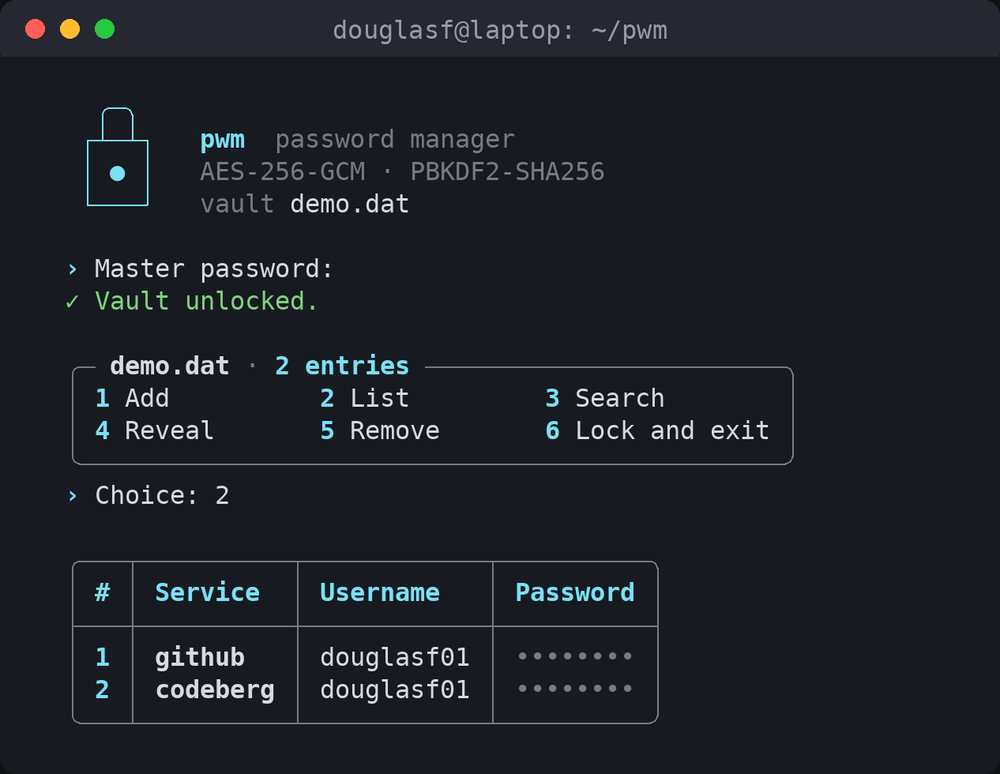
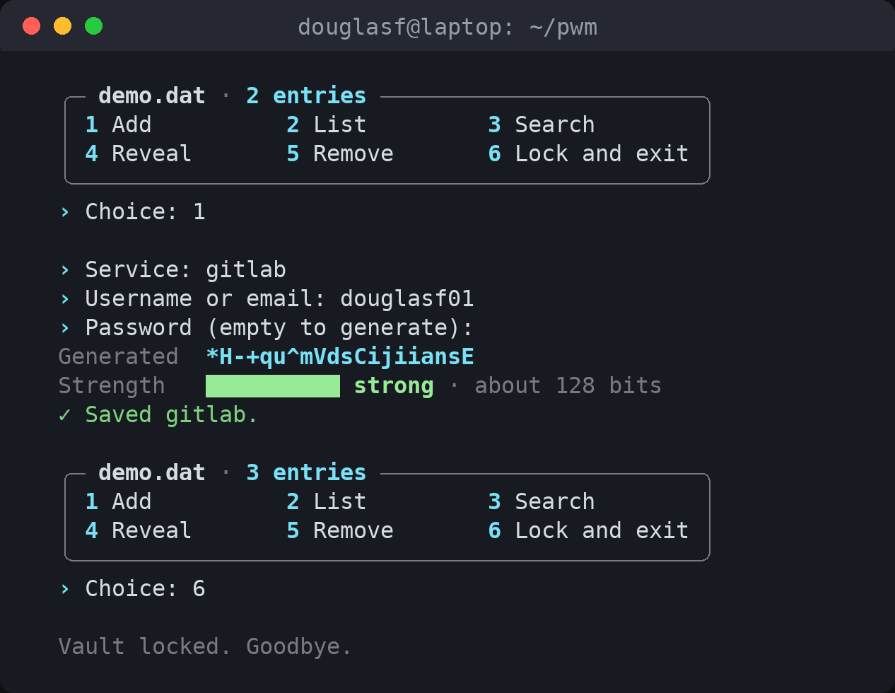

# CLI Password Manager

A small command line password manager written in C++17 with [Crypto++](https://www.cryptopp.com/).
All entries are kept in one encrypted vault file that is unlocked with a master password.





## Features

- A clean terminal look: a small banner, a boxed menu with the number of entries, and colored
  messages (green for success, yellow for warnings, red for errors).
- Entries are shown in an aligned table. Passwords are masked (`••••••••`) until you ask to
  reveal one.
- Add an entry (service, username, password). Leave the password empty and the program makes
  a random 20 character password for you.
- A strength meter for new passwords: a short colored bar and a word (weak, fair, good,
  strong). It is a rough estimate from length and character types only, so a real word with
  a digit on the end still scores higher than it should.
- Search entries by service name.
- Remove an entry by its number.
- Passwords are not shown on screen while you type them.
- Colors are turned off when the output is not a terminal or when `NO_COLOR` is set, so the
  program also works in scripts and pipes.

## Security design

- **Key derivation:** the master password is turned into a 256 bit key with PBKDF2-HMAC-SHA256,
  600,000 iterations and a random 16 byte salt. The salt and iteration count are stored in the
  vault header. The key itself and any hash of the master password are never stored.
- **Encryption:** the whole vault (all entries) is encrypted with AES-256-GCM. A fresh random
  12 byte IV is used on every save. The header (format version, iteration count, salt) is
  also covered by the GCM tag.
- **Unlocking:** there is no separate password check. If the master password is wrong, the GCM
  tag does not match and the vault does not open. You get 3 tries.
- **Tampering:** any change to the file also breaks the GCM tag, so it is detected the same way
  as a wrong password.
- **File handling:** the vault is written to a temporary file with `0600` permissions (only your
  user can read it) and then renamed over the old one, so a crash does not leave a broken vault.
- **Memory:** keys are held in Crypto++ `SecByteBlock` buffers, which are wiped when freed.
  The master password and decrypted data are wiped after use where the code controls the memory.

### Data format

```
"PWMV" | version (1 byte) | iterations (4 bytes) | salt (16 bytes) | IV (12 bytes) | ciphertext | tag (16 bytes)
```

Inside the ciphertext, each field is stored with its length in front of it, so commas,
newlines and other characters in a field are safe.

### Threat model

Protected:
- Someone who copies your vault file (for example from a backup or a stolen disk) can not read
  your entries without the master password. They have to guess it, and each guess costs
  600,000 PBKDF2 rounds.
- Changes to the vault file are detected.

Not protected:
- A weak master password. Use a long one.
- Malware or another user with access to your running session (key loggers, reading memory,
  watching the screen). While the vault is open, entries are in memory in plain text.
- Passwords shown with "Reveal" (or generated ones) stay visible in your terminal and its scrollback.
- Deleting the vault file. Keep backups.
- The program does not lock your account after failed tries. Someone with the file can keep
  guessing offline; only the slow key derivation and your password strength stop them.

## Build

Requires a Unix-like system, a C++17 compiler, CMake 3.18 or newer and Crypto++.

```sh
sudo apt install g++ cmake libcrypto++-dev
cmake -S . -B build
cmake --build build
```

This produces `build/password-manager`. Add `-DPWM_STATIC=ON` to the first `cmake` command to
link the program statically.

## Usage

```sh
./build/password-manager
```

On the first run the program creates a new vault and asks you to choose a master password
(at least 8 characters). After that it asks for the master password each time.

Then pick an option from the menu:

| Key | Action                                          |
|-----|-------------------------------------------------|
| 1   | Add an entry                                    |
| 2   | List all entries (passwords masked)             |
| 3   | Search entries by service                       |
| 4   | Reveal the password of one entry                |
| 5   | Remove an entry                                 |
| 6   | Lock the vault and exit (`q` also works)        |

The vault is stored in `vault.dat` in the current directory. To use another location, set
`PWM_VAULT`:

```sh
PWM_VAULT=~/.passwords.vault ./build/password-manager
```

**Note:** this vault format is new. Files from older versions of this program
(`master_hash.txt` and `passwords.txt`) can not be read. Older versions also stored the
encryption key next to the data, so those files should be deleted.

## Tests

```sh
cmake --build build
cd build && ctest --output-on-failure
```

The tests check that a vault saves and opens again, that a wrong password fails, that a changed
file is rejected, that fields with commas, newlines and zero bytes come back unchanged, and that
each vault gets its own salt and each save gets a new IV. They also cover the strength
estimate and the text helpers used for the table (cutting long text, and replacing control
characters so stored data can not send escape codes to your terminal).

To build with the address and undefined behaviour sanitizers:

```sh
cmake -S . -B build-asan -DCMAKE_BUILD_TYPE=Debug -DPWM_SANITIZE=ON
cmake --build build-asan
```

## Thanks

Thanks to Tsvetomir Dimitrov for his
[introduction](https://petanode.com/posts/brief-introduction-to-cryptopp/) to the Crypto++ library.
